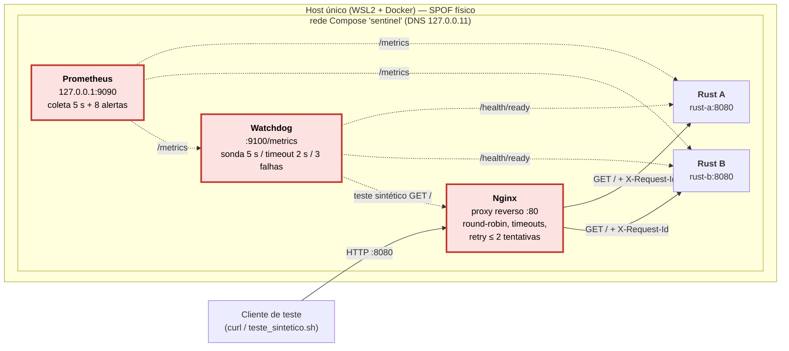

# Entrega A — Arquitetura e mapa dos pontos de falha (Hora 1)

## 1. Componentes e dependências

| Componente | Imagem / origem | Responsabilidade | Porta interna | Publicada no host | Depende de |
|---|---|---|---|---|---|
| **nginx** | `nginx:1.27.5-alpine` (Docker Hub oficial) | Proxy reverso; reparte `GET /` entre A e B (round-robin), aplica timeouts e retry limitado, gera `request_id` | 80 | `0.0.0.0:8080` (única porta de usuário) | rust-a, rust-b, DNS do Docker |
| **rust-a** | build local `./rust-app` (axum 0.7, Rust 1.90) | Atende usuário; `/health/live`, `/health/ready`, `/metrics`, `/admin/*` | 8080 | — | nada (sem banco) |
| **rust-b** | idem, `NODE_NAME=rust-b` | idem | 8080 | — | nada |
| **watchdog** | build local `./watchdog` (Python 3.12, só stdlib) | Sonda `/health/ready` de A e B a cada 5 s (timeout 2 s), DOWN após 3 falhas; **teste sintético** `GET http://nginx/`; expõe métricas | 9100 | — | rust-a, rust-b, nginx, DNS |
| **prometheus** | `prom/prometheus:v2.53.0` (Docker Hub) | Coleta métricas de A, B, watchdog e de si mesmo a cada 5 s; avalia 8 regras de alerta | 9090 | `127.0.0.1:9090` (só local) | rust-a, rust-b, watchdog |
| Rede `sentinel` | bridge do Compose | DNS interno (`127.0.0.11`) resolve nomes de serviço | — | — | Docker Engine |

## 2. Diagrama



Linhas contínuas: caminho do usuário. Tracejadas: observação (sondas e coleta).
Em vermelho: **pontos únicos de falha**. Todos os serviços escrevem logs em stdout
(`docker compose logs`), no formato `timestamp serviço NÍVEL request_id=… chave=valor`.

Versão ASCII (para slide/terminal):

```
                             +--------------------------------------+
                             |  WATCHDOG (SPOF do monitoramento)    |
                             |  sonda /health/ready 5s, 2s, 3 falhas|
                             +---+-------------+---------------+----+
                                 :ready        :ready          :sintético GET /
                                 v             v               v
 curl --HTTP:8080--> [ NGINX (SPOF) ] --GET /--> [ RUST A :8080 ]
                     round-robin       \--GET /--> [ RUST B :8080 ]
                     connect 1s/read 3s           ^      ^
                     retry: 2 tentativas          :      :  /metrics (5s)
                                             [ PROMETHEUS 127.0.0.1:9090 ] (SPOF dos alertas)
 ---------------- tudo dentro de UM host / UM Docker Engine (SPOF físico) ----------------
```

## 3. Mapa dos pontos de falha

| # | Ponto | É SPOF? | O que acontece se cair | Mitigação atual | Mitigação possível (fora do escopo) |
|---|---|---|---|---|---|
| 1 | **Nginx** | **Sim** (caminho do usuário) | Serviço inteiro indisponível: nada chega a A nem a B, mesmo saudáveis | `restart: on-failure:3`; healthcheck Docker; teste sintético do watchdog detecta (alerta `TesteSinteticoFalhando`) | 2 Nginx + IP virtual (keepalived) ou LB gerenciado |
| 2 | **Rust A / Rust B** | **Não** (redundância 2×) | O outro nó assume; 1–2 requisições pagam o `proxy_connect_timeout` (~1 s) até o Nginx retirar o nó | `max_fails=3 fail_timeout=10s`, retry em outro nó, `resolve` | Mais nós; *outlier detection* ativa |
| 3 | **Bug comum a A e B** | **Sim** (mesma imagem) | Balanceamento não ajuda: os dois falham igual (regra de ouro 5) | Alerta `TaxaErro5xxAlta`; Nginx **não** refaz em 500 | Deploy canário / versões diferentes |
| 4 | **Watchdog** | **Sim** (do monitoramento) | Sem sondas: ninguém marca DOWN; painel congela (cenário da Hora 7) | Alerta `MonitorParado` (idade da última sondagem > 30 s) avaliado pelo Prometheus | 2 watchdogs em pontos de rede diferentes |
| 5 | **Prometheus** | **Sim** (dos alertas) | Sem coleta e **sem nenhum alerta** — e nada avisa isso | Healthcheck Docker; sem Alertmanager | Prometheus em par / *dead man's switch* externo |
| 6 | **DNS interno do Docker** | Sim (compartilhado) | Nginx e watchdog não resolvem `rust-a`/`rust-b` | Nginx guarda o IP já resolvido entre re-resoluções (`valid=10s`) | — |
| 7 | **Host / Docker Engine** | **Sim** (físico) | Tudo cai junto; falhas não são independentes | Nenhuma (limite do laboratório) | Várias máquinas / zonas |
| 8 | **Relógio do host** | Não derruba, mas engana | Logs com horário fora de ordem; idade de métrica errada | Medido: saltos de −2,4 s / +5,1 s no WSL2 (evidência 10) — limiar de 30 s tem folga | NTP confiável; correlacionar por `request_id`, não por horário |

**Quem vigia o vigia?** O Prometheus vigia o watchdog (alerta `MonitorParado` e
`ColetaFalhando`). O Prometheus em si **não é vigiado por ninguém** de fora — é o
SPOF residual que declaramos. Em produção: um *dead man's switch* (alerta que
dispara sempre e cujo silêncio é o sinal de falha) num serviço externo.

## 4. Três hipóteses de falha (formato do enunciado)

| # | Hipótese "Se [evento], então [efeito], porque [mecanismo]" | Como testar | Status em 02/11 |
|---|---|---|---|
| H1 | **Se** o Rust A for parado, **então** o Nginx continuará respondendo 200 pelo Rust B, mas 1 a 3 requisições levarão ~1 s, **porque** o Nginx só retira o nó após `max_fails=3` falhas e cada tentativa espera o `proxy_connect_timeout` de 1 s antes de refazer em B. | `docker compose stop rust-a` + 20 `curl` | **Confirmada** (ev. 05, 05b, 05c): 20/20 com 200 em todas as rodadas; 3 requisições a ~1,09 s em `05c` e no ensaio, 2 em `05b` (a 3ª falha foi do teste sintético, achado 3) e 0 em `05` (A já estava fora do pool, achado 8) |
| H2 | **Se** o Rust A ficar lento (atraso de 2,5 s), **então** o watchdog o marcará DOWN mas o Nginx continuará enviando tráfego a ele e os usuários sentirão ~2,5 s em metade das requisições, **porque** o timeout da sonda (2 s) é menor que o atraso, enquanto o `proxy_read_timeout` do Nginx (3 s) é maior. Watchdog e Nginx discordarão. | `scripts/admin.sh atraso rust-a 2500` + 20 `curl` | Prevista para a Hora 6 |
| H3 | **Se** o watchdog for parado, **então** o serviço ao usuário não muda, mas em até ~35 s o alerta `MonitorParado` dispara e, enquanto isso, uma queda real de nó **não** geraria `NoDown`, **porque** a métrica `watchdog_last_probe_timestamp_seconds` para de avançar e o watchdog é o único que calcula DOWN. | `docker compose stop watchdog` e consultar `/alerts` | Prevista para a Hora 6 |
